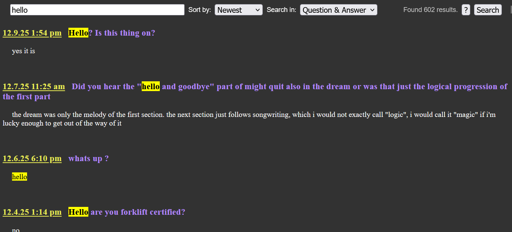

# Bill Wurtz Search

### A fan-made search tool for Bill Wurtz's [questions](https://billwurtz.com/questions/questions.html) page.
## Open it [here](https://billwurtz-search.github.io)!!

---

### Will you keep the questions up to date?
Yes. I try to do at least once a month.

---

### License
1) I **don't** own the logs; their content is property of Bill Wurtz.
2) The rest of this project (the *"software"*) is licensed under the [MIT license](LICENSE).

---

### Contact
Currently you should message my [Reddit account](https://reddit.com/user/Kuzeyy27).

Also, if you have actual serious issues with this, please still contact me in the same way. I will take it down.
